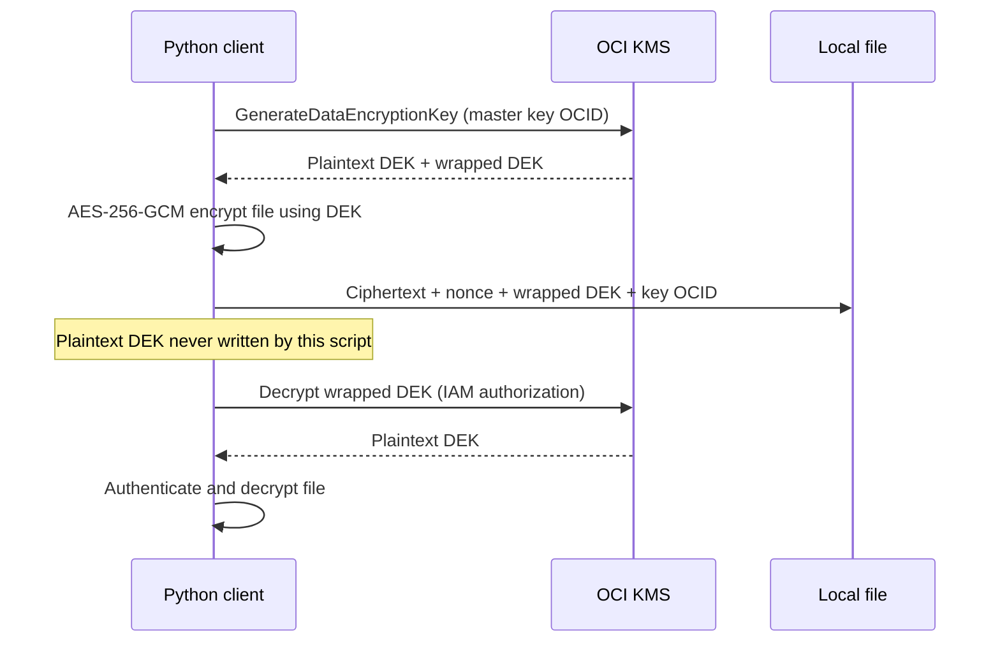

# OCI Vault: practical Python lab

**Escenario de la imagen: [Linux + Instance Principal + Dynamic Group + getsecret.py](instance-principal/README.md)**. Guía en español con VCN `10.0.0.0/16`, subred pública `10.0.1.0/24`, IAM y recuperación de secretos sin API signing key de usuario en la instancia.

**Nuevo: [exportación de llaves SOFTWARE, paso a paso en español](software-export/README.md)**. Incluye generación de RSA de envoltura, exportación con el SDK, desenvoltura y comprobación local. Script: `export_software_key.py`.

A 25–35 minute demonstration of envelope encryption, SSH credentials, and key lifecycle controls. Use disposable lab resources. Nothing in this package provisions or changes your cloud resources automatically. All commands target Linux with Bash, Python 3.10+ and OpenSSH. Run them from the project directory on the Linux runner.

## What the audience should learn

The term is **HSM**, hardware security module (rather than HCM).

| Property | HSM key | SOFTWARE key |
|---|---|---|
| Master key storage | Inside an HSM | Server storage, encrypted at rest under an HSM root key |
| Master key operations | Inside the HSM | On the service server |
| Export of master key material | Not permitted (asymmetric public keys can be retrieved) | Supported through a separate export workflow and permissions |
| This lab's application API | Generate DEK / decrypt wrapped DEK | Same |
| Where this lab encrypts file bytes | Locally, with a temporary data encryption key | Same |
| Change mode on an existing key | Cannot change; create another key | Cannot change; create another key |

HSM protection applies to the **master key**. Our plaintext data encryption key (DEK) exists in client memory in both modes. An SSH private key stored as a **secret** is encrypted data outside the HSM; reading the secret returns its plaintext to the authorized client. This is different from an HSM performing a signature without exporting its private key. Current OCI documentation places secrets under Secret Management Service; the Python retrieval client remains `oci.secrets.SecretsClient`.



## 1. Prepare the lab

Use Python 3.10+ with venv support and OpenSSH on the Linux runner. The main authentication path is **Instance Principal on OCI Compute**, following the setup guide linked above. It requires no user API signing key or OCI profile on the instance. The OCI CLI is optional and used only for the administrator rotation example.

```bash
umask 077
chmod 700 .
python3 --version
python3 -m venv .venv
.venv/bin/python -m pip install -r requirements.txt
cp -n config.instance-principal.example.json config.json
chmod 600 config.json
```

Edit `config.json` with your region, endpoints and OCIDs. Keep `auth` set to `instance_principal`. `cp -n` preserves an existing configuration; review it if the file already exists. All commands below run from this directory. If transferring the ZIP, extract it with `unzip oci-vault-demo.zip -d oci-vault-demo` and enter the resulting directory. Install Python/venv, OpenSSH and unzip through your Linux distribution's package manager if needed.

Optional Linux runner outside OCI: copy `config.example.json` instead, use `auth: "config"`, and configure your user OCI profile. That API signing key authenticates to OCI and is separate from the target's SSH login key. This optional mode does not use Instance Principal.

In the OCI Console, choose a lab compartment and region. Create a regular/default Vault (not a Dedicated KMS cluster and not a virtual private vault for this exercise). Wait for ACTIVE. Copy its **management** and **cryptographic** endpoints into `config.json`. Create these master encryption keys in the vault, waiting for ENABLED:

| Display name | Algorithm | Length | Protection mode |
|---|---|---|---|
| lab-hsm | AES | 256 bits (32 bytes) | HSM |
| lab-software | AES | 256 bits (32 bytes) | SOFTWARE |

Copy their OCIDs into `keys.hsm` and `keys.software`. Confirm `region` and `auth`; `profile` applies only to the optional config authentication mode. An ordinary Vault supports this comparison; Dedicated KMS supports HSM only. Check your tenancy's quotas and current pricing before provisioning; no cost estimate is assumed here.

An administrator can provision resources with these compartment-scoped lab policies (replace names; for identity domains use `'<domain>'/'<group>'` as appropriate):

```text
Allow group VaultLabAdmins to manage vaults in compartment VaultLab
Allow group VaultLabAdmins to manage keys in compartment VaultLab
Allow group VaultLabAdmins to manage secret-family in compartment VaultLab
```

Use the Linux runner's Dynamic Group for runtime access, replacing all placeholders:

```text
Allow dynamic-group VaultLabRunner to use keys in compartment VaultLab where target.key.id = '<HSM_KEY_OCID>'
Allow dynamic-group VaultLabRunner to use keys in compartment VaultLab where target.key.id = '<SOFTWARE_KEY_OCID>'
Allow dynamic-group VaultLabRunner to read secret-bundles in compartment VaultLab where target.secret.id = '<SSH_SECRET_OCID>'
```

The SDK's `get_key` metadata calls are covered by `use keys`. This permission also includes `KEY_EXPORT`, relevant to the SOFTWARE export lab. For encryption/decryption without export permission, use the explicit permissions in the Instance Principal guide. Reading a secret bundle is separate from using a KMS key; the SSH runtime does not need direct key-decrypt permission solely to retrieve a secret. Allow IAM changes to propagate.

Set `auth` to `instance_principal`, set `region`, and create the Dynamic Group matching only that runner instance (`instance.id = '<RUNNER_INSTANCE_OCID>'`). Do not give every instance in your tenancy secret access. The runner needs HTTPS access to KMS/Secrets endpoints; private subnets can use an OCI service gateway with suitable routes and security rules. Only for the optional user-profile mode, replace the Dynamic Group principal in the policies with the authorized IAM user group.

## 2. Encrypt and decrypt the same file using both modes (8 minutes)

Run from this directory:

```bash
.venv/bin/python vault_demo.py inspect
.venv/bin/python vault_demo.py encrypt --mode hsm sample.txt hsm.vault.json
.venv/bin/python vault_demo.py decrypt hsm.vault.json hsm.restored
.venv/bin/python vault_demo.py encrypt --mode software sample.txt software.vault.json
.venv/bin/python vault_demo.py decrypt software.vault.json software.restored
sha256sum sample.txt hsm.restored software.restored
cat hsm.vault.json
```

Expected: inspect reports HSM and SOFTWARE; all three SHA-256 hashes match. The JSON holds ciphertext, a nonce, an encrypted DEK, and a key OCID. The GCM authentication tag is included in ciphertext. Base64 is transport encoding, not encryption. Each encryption uses a fresh DEK and nonce, so outputs differ even for the same input. File contents stay local; KMS handles the DEK. Metadata labels alone cannot prove an HSM's physical behavior; `inspect` reads OCI's authoritative resource metadata.

## 3. Demonstrate tamper detection (3 minutes)

```bash
.venv/bin/python - <<'PY'
import base64, json
from pathlib import Path
p = json.loads(Path('hsm.vault.json').read_text())
c = bytearray(base64.b64decode(p['ciphertext']))
c[0] ^= 1
p['ciphertext'] = base64.b64encode(c).decode()
Path('tampered.vault.json').write_text(json.dumps(p))
PY
.venv/bin/python vault_demo.py decrypt tampered.vault.json tampered.restored
```

Expected: exit code 1, authentication failure, and no output plaintext file. GCM detects modified content in both protection modes. HSM protection does not replace authenticated file encryption.

## 4. Connect over SSH using a Vault secret (8 minutes)

Use a disposable Linux target reachable from the runner. Permit TCP 22 only from the runner's address or approved private network, and make sure its OS firewall allows it. Create a dedicated SSH key locally:

```bash
ssh-keygen -t ed25519 -f lab_ssh -C vault-lab
```

Choose a passphrase at the prompt. Through an existing trusted administrative session, install **only `lab_ssh.pub`** into the target user's `~/.ssh/authorized_keys`; use directory permissions 700 and file permissions 600. For OCI Oracle Linux the usual user is `opc`; for Ubuntu it is `ubuntu`. Do not replace existing authorized keys.

On the runner, protect the generated private key with `chmod 600 lab_ssh`. On the target, run these commands as the destination login user, then append the demo public key through your trusted session:

```bash
install -d -m 700 "$HOME/.ssh"
touch "$HOME/.ssh/authorized_keys"
chmod 600 "$HOME/.ssh/authorized_keys"
```

In OCI Secret Management, create a secret named `lab-ssh-private-key`, selecting the lab vault and `lab-hsm` AES key. Choose plaintext/manual secret content and paste the **complete contents of `lab_ssh`**, including BEGIN/END lines and actual newlines. This is the private file, not `.pub`; do not base64-encode it yourself when using plaintext input. Copy the resulting secret OCID into `ssh_secret_id`. Grant the runtime identity the secret-bundle policy from step 1.

Build a trusted `known_hosts` file. Obtain the target's SSH host public key/fingerprint through a trusted console/admin channel. You can collect a candidate with `ssh-keyscan -t ed25519 <HOST>`, but verify its SHA-256 fingerprint against that trusted channel before saving the matching line to `known_hosts`. `ssh-keyscan` by itself does not authenticate the server. For a nondefault SSH port the known-hosts hostname is `[HOST]:PORT`.

```bash
.venv/bin/python vault_demo.py ssh --host '<HOST_OR_IP>' --user opc --known-hosts known_hosts --prompt-passphrase
```

Expected: target username and hostname. Paramiko retrieves the CURRENT secret version, decodes the private key in memory, checks the server's host key, and authenticates. It disables SSH-agent and local-key fallbacks so success demonstrates use of the retrieved secret. The demo never writes the retrieved key to a temporary file. The original provisioning file still exists locally until you remove it according to your lab's retention rules; do not show its contents during the presentation.

Explain: OCI IAM controls who retrieves the credential; `authorized_keys` controls which credential can log in to Linux. Vault does not install keys on the target. HSM-generated nonexportable signing keys are not a drop-in replacement for OpenSSH private-key files in this demo.

Optional extension: generate a second SSH key, add its public key to `authorized_keys`, upload its private key as a new CURRENT secret version, then rerun SSH. Only after confirming success, remove the old public key from the target. Changing the Vault secret alone does not revoke the old key on the host, terminate sessions, or invalidate copies already retrieved.

## 5. Useful lifecycle examples (5–8 minutes)

### Rotation without breaking old files

As the lab administrator, rotate one demo master key in the Console (create a new key version), or use this Bash command after replacing values:

```bash
oci kms management key-version create --auth instance_principal --key-id '<HSM_KEY_OCID>' --endpoint '<MANAGEMENT_ENDPOINT>'
```

This CLI command requires an administrator-authorized instance identity with rotation permission. The normal runtime Dynamic Group does not have that permission. Alternatively rotate through the administrator's Console session; no CLI is needed on the runner.

Wait for the key to be ENABLED. Run `inspect` again: key OCID is unchanged, current version changes. Decrypt `hsm.vault.json` to a **new** output such as `after-rotation.restored`; it still works because old AES versions remain available for decryption. Encrypt another file: it uses the current version. Rotation does not re-encrypt existing envelopes. Repeat on the software key to show the same lifecycle behavior.

### Temporary disablement as an access control demonstration

Use only the disposable `lab-software` key, which is not backing the SSH secret. Disable it in the Console, wait for DISABLED, then attempt to decrypt `software.vault.json` to `disabled.restored`: the KMS call should fail. Re-enable, wait for ENABLED, and retry to a new filename: it succeeds. Repeat with a separate disposable HSM key if desired. Key disablement requires administrator permissions, deliberately excluded from runtime policies.

Explain the boundary: disablement blocks subsequent KMS operations. It cannot erase plaintext files, revoke DEKs already held in application memory, or terminate existing SSH sessions. Never disable a production key to perform this demonstration.

### Observe access in Audit

In OCI Audit, filter the lab compartment and time window for `GenerateDataEncryptionKey`, `Decrypt`, and `GetSecretBundle`. Identify the caller, resource, timestamp, result, and request ID. Do not expect logs to contain secret payloads. Allow ingestion delay. A second identity without secret-bundle access should fail to retrieve the SSH credential; OCI may report 404 NotAuthorizedOrNotFound rather than a simple 403.

## Limits, troubleshooting, and cleanup

- This is a small-file example: up to 16 MiB, loaded in memory. Production large files require a reviewed streaming format. It uses AES-GCM locally and OCI-generated AES-256 DEKs; it never exports the master key.
- Output files are created exclusively, so reruns need new names. Store recovered plaintext in a private directory. Use a private directory with mode 700 and `umask 077`; the Python scripts create output files with mode 600.
- Python cannot guarantee erasure of immutable secret/key copies in memory. Run on a trusted machine, avoid debug payload logging, and close the process after the demo.
- 404/authorization errors: verify region, compartment, OCIDs, profile, dynamic group membership, and policy propagation. Inspect fails if endpoint or key is from a different vault.
- SSH errors: verify routing/port, username, matching public key, host-key entry, and passphrase. Missing or changed host keys are rejected deliberately.
- Keep any retained ciphertext's master key versions available. Delete only the lab resources after you no longer need the data; use OCI's scheduled deletion workflow and observe its waiting period. Remove the demo public key from the target and delete lab secrets/keys/vault and disposable Compute/network resources as appropriate. Remove local private keys and recovered plaintext under your normal retention policy. This package executes no cleanup automatically.

## Validation

`.venv/bin/python -m unittest -v test_vault_demo.py` runs offline tests with a fake KMS wrapping layer: real AES-GCM round trips in both logical modes, ciphertext tampering, refusal to overwrite outputs, unknown-key rejection, and SSH retrieval with mocked transport. These do not validate OCI IAM, HSM hardware, endpoint connectivity, or an actual SSH server. Perform the steps above for live acceptance.

## Official references

- [OCI key concepts, protection modes, envelope encryption, rotation](https://docs.oracle.com/en-us/iaas/Content/KeyManagement/Concepts/keyoverview.htm)
- [Python KmsCryptoClient API](https://docs.oracle.com/en-us/iaas/tools/python/latest/api/key_management/client/oci.key_management.KmsCryptoClient.html)
- [Vault/KMS/Secrets IAM policy reference](https://docs.oracle.com/en-us/iaas/Content/Identity/policyreference/keypolicyreference.htm)
- [Retrieving secret bundles](https://docs.oracle.com/en-us/iaas/Content/secret-management/Tasks/view-secret-properties-all-version.htm)
- [CLI manual key rotation](https://docs.oracle.com/en-us/iaas/tools/oci-cli/latest/oci_cli_docs/cmdref/kms/management/key-version/create.html)

Documentation checked November 2, 2026. Resource names and OCIDs in this package are placeholders.
