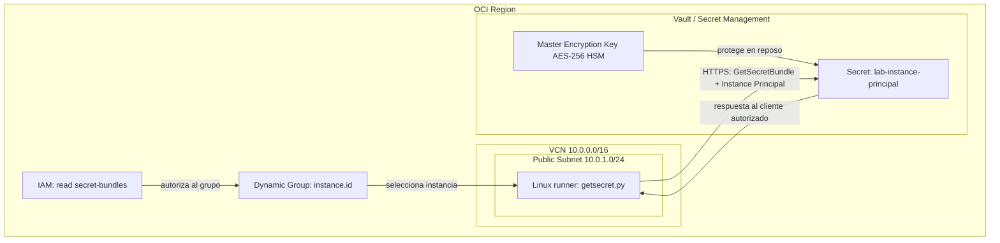

# Escenario de la imagen: Instance Principal + Vault + IAM

Esta guía incorpora el setup que compartiste a la [demo principal](../README.md). Una instancia Linux ejecuta `getsecret.py`, se autentica mediante **Instance Principal**, pertenece a un **Dynamic Group** y obtiene el contenido de un secreto autorizado por una política IAM. El secreto está cifrado con una Master Encryption Key del Vault.

## 1. Entender los componentes

| Componente de la imagen | Implementación en este laboratorio |
|---|---|
| OCI Region | Una región elegida para Vault, secreto y Compute |
| VCN | `10.0.0.0/16` |
| Public Subnet | `10.0.1.0/24` |
| Linux Instance | Runner de Python, con acceso saliente HTTPS |
| Master Encryption Key | `lab-hsm`, AES-256, para proteger el secreto |
| Secret | `lab-instance-principal`, contenido ficticio `vault-demo-ok` |
| Feed Secret OCID | Argumento `--secret-id` de `getsecret.py` |
| Dynamic Group | Regla que selecciona la OCID exacta del runner |
| IAM Policy | `read secret-bundles`, restringido al secreto de prueba |



Las flechas son lógicas: una política no se instala en la VM. IAM evalúa la identidad y la pertenencia al grupo al atender las llamadas. El Vault tampoco reside dentro de tu subred. El script recibe la OCID del secreto; la OCID es un identificador, no una contraseña. La MEK permanece en KMS y el servicio entrega el contenido del secreto al cliente autorizado.

## 2. Crear la red y la instancia Linux

En un compartimento de laboratorio, crea una VCN `10.0.0.0/16`, un Internet Gateway y una subred pública regional `10.0.1.0/24`. Usa estos CIDR solo si no se superponen con redes que ya tengas conectadas.

Configura:

- Ruta `0.0.0.0/0` de la subred hacia el Internet Gateway.
- Runner Linux con IPv4 pública para esta variante del laboratorio.
- Ingreso TCP 22 únicamente desde tu IP administrativa `/32`, mediante NSG o security list. Instala la llave SSH pública administrativa al crear la instancia.
- Salida TCP 443 hacia los servicios OCI, con DNS funcional. Si restringes la salida, contempla autenticación/federación además de Secrets y KMS. Las reglas stateful permiten el tráfico de respuesta.

Conéctate desde tu equipo mediante tu sesión SSH habitual, con host key verificada. En Oracle Linux normalmente se usa `opc`; en Ubuntu, `ubuntu`. Copia la **OCID de la instancia runner** desde su página en Compute.

Una subred pública por sí sola no asegura conectividad: se requieren dirección pública, ruta y reglas de salida apropiadas. Como variante privada, usa una subred sin IP pública y un Service Gateway para servicios OCI compatibles, rutas y reglas hacia `All <region> Services in Oracle Services Network`; la administración puede hacerse mediante Bastion. Para reproducir la imagen utiliza primero la variante pública.

## 3. Crear Vault, MEK y secreto

Como administrador del laboratorio, usa el Vault de la demo principal o crea uno regular en la región elegida. Crea o reutiliza `lab-hsm`, AES-256 con protección HSM y estado ENABLED.

En Secret Management crea `lab-instance-principal`, seleccionando ese Vault y esa MEK. Usa contenido manual/plaintext **ficticio**:

```text
vault-demo-ok
```

Selecciona o confirma la versión CURRENT y copia la **OCID del secreto**, que comienza con `ocid1.vaultsecret...`. No uses la OCID de la llave (`ocid1.key...`) ni la del Vault (`ocid1.vault...`). El contenido del secreto no reside dentro del HSM: está cifrado mediante la MEK.

El administrador necesita los permisos de creación descritos en la guía principal. El runner solo necesita recuperar el secreto; no necesita administrar Vaults ni crear secretos.

## 4. Crear el Dynamic Group

En IAM, crea un Dynamic Group llamado `VaultLabRunner` con una regla que seleccione únicamente la instancia de prueba:

```text
instance.id = '<OCID_INSTANCIA_RUNNER>'
```

Reemplaza el marcador completo por la OCID real y conserva las comillas simples. Esta regla usa la identidad de la VM, no su dirección IP. Evita seleccionar todas las instancias del compartimento para este laboratorio. En tenancies con identity domains, crea el grupo en el dominio correspondiente y usa su nombre calificado en las políticas cuando sea necesario.

## 5. Crear la política de lectura del secreto

En la tenancy o en un ámbito padre que cubra el compartimento del **secreto**, crea:

```text
Allow dynamic-group VaultLabRunner to read secret-bundles in compartment VaultLab where target.secret.id = '<OCID_SECRETO_DE_PRUEBA>'
```

Si tu tenancy requiere calificar el dominio, el principal tendrá una forma como:

```text
Allow dynamic-group 'Default'/'VaultLabRunner' to read secret-bundles in compartment VaultLab where target.secret.id = '<OCID_SECRETO_DE_PRUEBA>'
```

Sustituye `Default`, `VaultLab` y las OCID por tus valores. Aplica la variante que corresponda a tu IAM. Para reflejar el permiso más amplio de la imagen, se podría omitir la condición `where`, pero el ejemplo restringe la lectura a un secreto concreto.

`read secrets` permite consultar metadatos; para recuperar el contenido se necesita **`read secret-bundles`**. La VM no necesita permiso directo `KEY_DECRYPT` sobre la MEK para este flujo de lectura del bundle. Espera la propagación de la política y de la pertenencia al Dynamic Group; puede no ser inmediata.

## 6. Copiar el proyecto e instalar Python

Copia el ZIP actualizado a la VM mediante tu conexión de administración y extráelo en un directorio de tu usuario. Los comandos siguientes se ejecutan **dentro de `oci-vault-demo`**, donde están `getsecret.py` y `requirements.txt`.

En Linux, con Python 3.10+ y el módulo venv disponibles:

```bash
umask 077
chmod 700 .
python3 --version
python3 -m venv .venv
.venv/bin/python -m pip install -r requirements.txt
```

Si solo ejecutarás `getsecret.py`, basta con instalar `oci` dentro de ese venv. Instala Python/venv mediante el gestor de paquetes de tu distribución si faltan.

No ejecutes `oci setup config` para este flujo. No copies una API signing key de usuario a la instancia: el SDK obtiene la identidad temporal de la VM mediante metadata y crea el token de autenticación. El acceso inicial por SSH sigue siendo un mecanismo separado.

## 7. Ejecutar getsecret.py desde la instancia

Sustituye la región y la OCID antes de ejecutar:

```bash
.venv/bin/python getsecret.py \
  --region us-ashburn-1 \
  --secret-id '<OCID_SECRETO_DE_PRUEBA>'
```

Salida ilustrativa si almacenaste exactamente `vault-demo-ok` sin salto de línea:

```json
{"auth":"instance_principal","secret_id":"ocid1.vaultsecret...","version_number":1,"stage":"CURRENT","bytes":13,"retrieved":true}
```

La versión y el tamaño pueden variar. Por defecto no se imprime el secreto. Para enseñar únicamente el contenido **ficticio** creado en el paso 3:

```bash
.venv/bin/python getsecret.py \
  --region us-ashburn-1 \
  --secret-id '<OCID_SECRETO_DE_PRUEBA>' \
  --show
```

Verás una segunda línea: `{"demo_secret_text": "vault-demo-ok"}`. No uses `--show` con contraseñas reales ni llaves SSH privadas.

El código crea `InstancePrincipalsSecurityTokenSigner`, llama a `SecretsClient.get_secret_bundle(stage="CURRENT")` y decodifica el contenido BASE64. No guarda el secreto en un archivo ni lee `~/.oci/config`. Se requiere ejecutar en OCI Compute con metadata accesible; tu laptop no obtiene la identidad de esa VM por tener su OCID.

## 8. Conectar este setup con SSH, cifrado y exportación

Copia `config.instance-principal.example.json` a un archivo nuevo llamado `config.instance.json` y reemplaza endpoints, región, ambas OCID de llaves y `ssh_secret_id`. Este último debe identificar **el secreto que contiene la llave privada SSH**, no el secreto ficticio `vault-demo-ok`.

### SSH autenticado con un secreto

Agrega otra política de lectura al mismo Dynamic Group, restringida a la OCID del secreto SSH. Instala la llave pública correspondiente en `authorized_keys` del **host destino**, verifica su host key y permite TCP 22 desde el runner. Después ejecuta desde el runner:

```bash
.venv/bin/python vault_demo.py --config config.instance.json ssh \
  --host '<HOST_DESTINO>' --user opc \
  --known-hosts known_hosts --prompt-passphrase
```

El runner se autentica ante OCI mediante Instance Principal, recupera la llave privada del secreto y se autentica ante el destino por SSH. Puedes usar una segunda VM como destino. El escenario de la imagen solo requiere una VM para `getsecret.py`.

### Cifrado con las dos MEK

Agrega permisos explícitos para cada llave utilizada, restringidos por OCID:

```text
Allow dynamic-group VaultLabRunner to {KEY_READ, KEY_ENCRYPT, KEY_DECRYPT} in compartment VaultLab where target.key.id = '<OCID_LLAVE_HSM>'
Allow dynamic-group VaultLabRunner to {KEY_READ, KEY_ENCRYPT, KEY_DECRYPT} in compartment VaultLab where target.key.id = '<OCID_LLAVE_SOFTWARE>'
```

```bash
.venv/bin/python vault_demo.py --config config.instance.json inspect
.venv/bin/python vault_demo.py --config config.instance.json encrypt --mode hsm sample.txt ip-hsm.vault.json
.venv/bin/python vault_demo.py --config config.instance.json decrypt ip-hsm.vault.json ip-hsm.restored
```

Para exportar SOFTWARE desde esta misma identidad, concede **además** `KEY_EXPORT` para esa llave de laboratorio y sigue la [guía de exportación](../software-export/README.md), usando `--config config.instance.json` en el comando `export`. `use keys` también incluye exportación; los permisos explícitos anteriores la excluyen salvo que otra política la conceda.

## 9. Verificación y diagnóstico

- **Éxito de lectura:** `retrieved: true`, versión CURRENT y tamaño esperado. Busca `GetSecretBundle` en OCI Audit, filtrando por intervalo y compartimento; permite demora de ingestión. Revisa identidad, recurso y resultado, sin esperar el contenido secreto en el registro.
- **Acceso no autorizado:** intenta leer un segundo secreto ficticio al que el runner no tenga permiso. Debe fallar si ninguna otra política le otorga acceso. OCI puede responder 404 `NotAuthorizedOrNotFound`.
- **Fallo antes de llamar a Secrets:** verifica que se ejecuta en la VM correcta, acceso a metadata, DNS, HTTPS y autenticación/federación. Si hay proxy, excluye metadata según la configuración de tu entorno. No descargues ni muestres certificados o llaves de identidad durante la presentación.
- **Fallo de permisos:** compara las OCID de runner y secreto, dominio, ámbito de la política y pertenencia al grupo; espera propagación. Un token creado antes de un cambio de grupo puede necesitar renovación.
- **Seguridad del runner:** los procesos con acceso a la identidad de instancia pueden aprovechar sus permisos. Limita acceso administrativo y protege metadata conforme a las políticas de tu organización.

Pruebas locales del script, sin red ni SDK instalado:

```bash
.venv/bin/python -m unittest -v test_getsecret.py
```

Estas pruebas simulan el SDK; la aceptación real requiere ejecutar el paso 7 desde tu VM. Al terminar, elimina los recursos de laboratorio que ya no uses y retira las políticas temporales. No se crean ni eliminan recursos automáticamente.

## Documentación oficial

- [Calling Services from an Instance: Dynamic Groups e Instance Principal](https://docs.oracle.com/en-us/iaas/Content/Identity/Tasks/callingservicesfrominstances.htm)
- [IAM de Vault/Secrets: secret-bundles y permisos de llaves](https://docs.oracle.com/en-us/iaas/Content/Identity/policyreference/keypolicyreference.htm)
- [Recuperación de versiones y contenido de secretos](https://docs.oracle.com/en-us/iaas/Content/secret-management/Tasks/view-secret-properties-all-version.htm)
- [Protección de Compute y acceso a metadata](https://docs.oracle.com/en-us/iaas/Content/Security/Reference/compute_security.htm)

Verificado el 2 de noviembre de 2026. La imagen proporcionada se usa como referencia de arquitectura; esta guía concreta los permisos, la conectividad y los pasos de ejecución.
